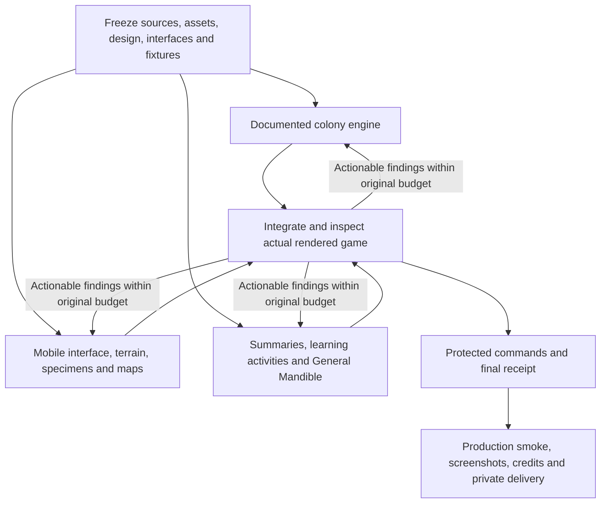

# Atlas verification and delivery

Status: final protected check passes. Production LAN smoke passes both engines. Verified source commit16985713fc7c389616f5af72a951418bea49f199 was pushed to the existing private repository and independently read back from GitHub; delivery is complete.

Original execution start2026-10-14T17:33:35Z; absolute deadline23:33:35Z. Baselinee5cb50c885185daacb59b014a5e1127a24c7d0a0. One initial attempt and eight shared repairs; one active goal, no token budget. Root owns integration; isolated engine, interface and learning lanes share the same deadline and fixtures.

## Protected checks and budget

Active contract/receipt: verification/atlas-repair-contract.json and atlas-repair-receipt.json. All declared npm checks use the pinned completion helper. Source metadata, assets, scientific data, global tokens, dependencies, fixtures and verifier configuration are protected.

Initial attempt in atlas-execution-receipt passed typecheck/lint/49 unit tests/build. Browser cases could not load because Node22 required a JSON import attribute. The independently reviewed declaration-only correction preserves all assertions and fixture bytes; see ATLAS_BROWSER_LOADER_REPAIR.md. Its successor’s initial run is shared repair1; seven further repairs remain on that contract. Original deadline is retained.

Shared repair1 passed typecheck/lint/49 units/build and42/50 browser cases. Four source causes repeated in both engines: owned tap retargeting after pointer capture; missing native-range world context marker; date summary appearing after a hidden native-select option; menu illustration-credit contrast. Failed command logs and traces remain local. Shared repair2 corrected those plus confirmed320px nest-label crowding and enlarged-text home/article/header wrapping. It passed 48/50 browser cases; only a duplicated native-context geographic heading remained. Shared repair3 removed the redundant card heading without changing any assertion. All five commands and the final helper check now pass: 49 unit tests and 50 browser cases. The active receipt counts 3 attempts/2 internal repairs; including the preserved initial contract, this is one initial attempt plus 3 shared repair runs.

## Independent inspection

Chromium and WebKit:1440×1000,768×1024,320×568,375×667,390×844,414×896 and844×390 short landscape. Initial grouped UI repair passed126 primary-path accessibility/layout audits, all visible controls44px minimum, no horizontal document overflow. Ten enlarged Details/specimen cases also pass. These are computed-font proxies, not physical iPhone text-size proof.

Independent learning inspection completed18 activity completion/replay/skip paths across desktop390/320 in both engines, with sources, no match-state effects, one reading scroller and18 scoped accessibility audits. Four introductory panels and three vignettes work with captions/manual/reduced-motion controls; explicit optional playback advances at most four panels, seven seconds each. WebKit keyboard focus was checked with macOS full-keyboard navigation.

Independent engine/runtime inspection passed16 checks in Chromium desktop and WebKit phone:42War nests, nine immutable references, exact starting reserves, sixSA rival nests, compatibility/unknown withdrawal and waiting conservation, gateway invalidation, regional rules and paused-screen state. Eight natural-AI runs reached 300 game seconds or a legitimate earlier result without nonfinite/negative units. War and meat-ant Species remained running at300s; Argentine Species lost at214.9s; Ecologist completed300s/defeat at0.5338887525974518 habitat retention without player intervention.

Settled mobile canvas renders full terrain/trails in both engines. An early capture immediately after resize showed an incomplete frame;250ms and later captures plus foreground frame sampling confirm stable terrain and readable controls. No product fallback or timer change was required.

## Sources and assets

60 assignments resolve55 individually reviewed primary photographs, with five compatible Australian cross-mode reuses; 16 retained regionalOpen/Complex examples remain. Full composition, real locality, creator, source/license, review date and resize provenance are visible. No generated habitat photographs or unverified-rights substitution. See [western credits](ATLAS_HABITAT_WEST.md), [eastern credits](ATLAS_HABITAT_EAST.md) and public/habitats/*/credits.json.

Dated evidence:2010 historical recognition samples/explicit pairwise assays,162regional anchors from the published15June 2022 distribution snapshot, and 295California GPS observations with NOAA geometry. Source-backed occurrences never establish colony identity or current fronts. Colony cooperation is a disclosed game simplification. Original research files stay byte-identical. [Research source pack](ATLAS_RESEARCH_SOURCE_PACK.md) records publication/observation dates, precision, licenses and transformations.

[Art and motion](ATLAS_ART_AND_MOTION.md) records the original General Mandible raster, captions/fiction separation and pinned Transitions.dev reference. Motion Primitives remains a visual reference; Game Studios informed rendered-game inspection and lane ownership. No third-party CLI/hooks/remote instruction loader/runtime package/engine migration.

## Evidence integrity and limits

Initial supplemental capture filenames were refreshed during capture repair before exact initial bytes were preserved. Two receipt-bound preliminary paths no longer reproduce their historical capture hashes. Original written findings and all five original command logs remain intact. This historical capture gap is disclosed; final proof uses unique, preserved confirmation filenames and hashes. No receipt stamps or failed logs are rewritten.

Physical iPhone Brave, native screen-reader sessions, enjoyment and learning/balance assessment remain human acceptance. No hosting is configured. Comfy was excluded throughout; 8000 stays reserved. Port5173, no backend/API/account/new runtime dependency, in-memory matches and existing tokens remain.

## Final delivery evidence

Final check: complete, exit0. Production smoke: Chromium and WebKit390×844, HTTP 200, all three modes, native owned taps, rally/auto, habitat decode/source links, local specimen controls, three research layers, summary/activity/comic, restart/exit/Cancel focus, no errors or development bridge. Final command logs, independent reports and94build-file hashes are archived in [docs/verification/atlas](verification/atlas). Source/fixture hashes remain unchanged after the final run.

Fresh phone home/filter/topic/species/Paraná controls pass normal/200% in both engines, including separated reading-header buttons; see learning-header-confirmation.json. Native context has one geographic heading, zero game nests and unchanged paused state on return. Required physical-device and enjoyment limits remain.

Build warning retained:503.98kB entry (134.50kB gzip), slightly above 500kB threshold; no threshold change. No release-blocking findings remain in agent verification. Screenshots and build/LAN instructions are indexed in [HANDOFF](../HANDOFF.md).
