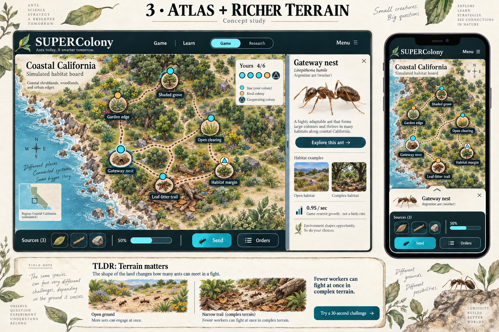

# Approved richer-atlas direction

The user reattached and reaffirmed **Atlas + richer terrain** on 2026-10-14
after rejecting the prior world and regional appearance. This image is the
visual source of truth for the correction:

- Reference: `docs/design/atlas-richer-terrain-approved.png`
- SHA-256: `70f456abdef293488b0c1fa0bff44e8f31366737597469e45e52517611642162`
- Frozen criteria: `verification/visual-direction-acceptance.json`
- Current review: `verification/visual-direction-review.json`
- Guard: `node scripts/direction-guard.mjs`

## What the player should see

The primary task is to command nests and follow swarms on an engaging,
readable habitat board. Detailed original illustration is the playing surface:
coastlines, foliage, woodland, open ground, rocks, fallen wood, and readable
clearings. Trails belong within that landscape. Faint procedural decoration
behind the existing node graph does not satisfy this direction.

Use the existing mineral-blue water, moss terrain, warm-paper reading surfaces,
charcoal controls, and cyan/amber tactical signals. Keeping those tokens does
not require keeping the old composition. Ownership symbols, reserve counts,
focus, and touch targets must remain legible over the art.

The approved illustration is a composition and quality reference. Its fictional
nest positions, sample ownership counts, descriptive copy, and decorative
lettering are not new gameplay or scientific requirements. Ship responsive,
semantic controls and existing truthful content rather than flattening the
mockup into a screenshot.

## Frozen visual targets

| Criterion | Observable expectation |
| --- | --- |
| `rich-illustration` | Detailed landscape fills the playable regional board; the world surface receives a coherent illustrated atlas treatment. |
| `landscape-trails` | Trails read as routes through the landscape, with movement and tactical ownership still distinguishable. |
| `habitat-medallions` | Nest markers carry recognizable habitat imagery as well as readable reserves and ownership signals. |
| `paper-inspector` | A specimen-led paper inspector connects the selected nest, species, habitat examples, and game growth explanation. |
| `compact-chrome` | Header and command dock leave the board dominant; required actions remain obvious and operable. |
| `mobile-composition` | Phone play is intentionally composed around the illustrated board, with readable destinations and accessible compact controls. |

Required surfaces are world, California desktop, California phone, other
regions, inspector, and terrain summary. Inspect desktop, tablet, narrow phones,
and short landscape using the viewports in the acceptance file. Record actual
findings for each; missing or unreviewed surfaces block the visual claim.

## Cheap direction check before rollout

Start with a working California board and compact shell. Capture the actual
desktop and phone game beside the approved study. Compare landscape detail,
board dominance, trail treatment, nest medallions, inspector hierarchy, and
mobile composition. Correct the slice before applying it across regions.

After each meaningful visual milestone or 20 active minutes, update the
existing handoff with evidence and the next bounded action. This correction
retains the original deadline, **2026-10-14T23:33:35Z**, and the shared repair
budget; it does not start another six-hour loop.

## Evidence guard and its limits

The guard rejects a missing, failed, unreviewed, or stale review. It checks the
approved reference's exact path and pinned hash, the hashes of every declared
artifact and screenshot, all required surface and criterion findings, and the
reviewer's name and inspection method. Evidence paths must stay inside the
repository and cannot use symlinks. It uses Node's built-in modules, with no
hooks, CI, background process, network call, or additional dependency.

The reviewer must actually open the rendered game and the reference. Preserve
the prior review and evidence at a distinct historical path before replacing
the current report. Re-render and re-review after changing any reviewed source
or artwork; do not merely update hashes to clear a stale finding. Record all
visual source/art dependencies in `artifactFiles` so the review covers what was
served.

The script establishes evidence integrity, not artistic quality. Review prose
can still be wrong, and a green engineering check cannot establish the desired
appearance. User rejection invalidates the affected visual acceptance. Human
feedback, physical iPhone Brave testing, enjoyment, and balance remain separate
acceptance steps. This rule is scoped to SUPERColony visual work, not a new
blanket approval requirement for unrelated engine or documentation changes.
